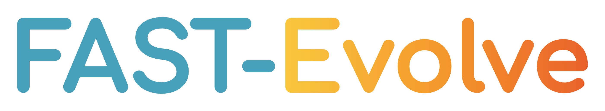

<div align="center">



**English** | [中文](https://gitcode.com/openJiuwen/FAST-Evolve)

</div>

## 🌱 Overview

FAST-Evolve is an all-in-one agentic evolution toolchain for algorithm optimization. Given a problem description and evaluation criteria, it drives coding agents to autonomously explore and evolve algorithm designs using evaluation feedback, yielding a steady stream of better solutions.

FAST-Evolve currently provides program evolution capabilities for coding agents through **EvoTrias**. By integrating an optimization task and an evaluator into a workspace, it drives agents to continuously generate, evaluate, and select candidate programs. EvoTrias supports Claude Code and OpenCode. See the [EvoTrias documentation](evo_trias) for detailed usage.

## 🚀 Quick Start

This example uses the built-in Circle Packing task, which aims to place 26 non-overlapping circles inside a unit square while maximizing the sum of their radii.

Prepare Python 3.11 or later, and install and configure Claude Code and its model service. We recommend installing dependencies in a Python virtual environment.

### 1. Get the Code and Install

```bash
git clone https://github.com/openJiuwen-ai/FAST-Evolve.git
pip install ./FAST-Evolve/evo_trias
pip install -r FAST-Evolve/benchmarks/requirements/math.txt
evotrias --version
```

### 2. Create a Workspace and Import the Task

Create a workspace alongside the repository and initialize EvoTrias:

```bash
mkdir my-workspace && cd my-workspace
evotrias setup
```

Follow the prompts to select a coding agent and complete the installation. Then copy the task skill into the selected agent's skills directory:

```bash
# Claude Code
cp -r ../FAST-Evolve/benchmarks/skills/circle-packing .claude/skills/
# OpenCode
cp -r ../FAST-Evolve/benchmarks/skills/circle-packing .opencode/skills/
```

### 3. Start Evolution

```bash
evotrias
```

Enter the following in the agent session:

```text
/evolve evolve circle-packing, 2 initial directions, 2 in parallel, 10 tasks
```

After you confirm the run parameters, EvoTrias explores two initial directions, runs up to two tasks in parallel, and iterates within a budget of 10 tasks. Follow progress at the dashboard URL printed during the run, and review the summary at `runs/<run_id>/run_summary.md` in the workspace when the run finishes.

To integrate custom optimization tasks or use other coding agents, see the [EvoTrias documentation](evo_trias) and [benchmark task examples](benchmarks/skills/).

## 🏗️ Architecture Overview

EvoTrias separates the evolution process into governance, proposal, and judgment:

| Component | Responsibility |
| --- | --- |
| Structured Governance | The controller manages task budgets, scheduling, and search state, using evaluation evidence to select subsequent exploration directions. |
| Open Proposal | Coding agents explore optimization strategies and generate and modify candidate programs. |
| Protected Judgment | Evaluators check candidate validity and compute fitness, providing feedback for selection and the next iteration. |

These components collaborate through explicit task and result contracts, forming a loop of proposal → evaluation feedback → selection and iteration.

## ✨ Features

- 🔌 **Plugin Integration**: Integrate evolution capabilities into coding agent workspaces through skills, an MCP server, and hooks.
- 🧭 **Parallel Exploration**: Explore multiple initial directions in parallel and continuously optimize within a task budget.
- 🔄 **Evaluation-Driven Search**: Select candidates based on validity and fitness, capture useful experience as Notes, and generate strategy guidance when search stagnates.
- 🛡️ **Evaluation Access Control**: In Claude Code, permission hooks restrict access to evaluator source code and other tasks' results.
- 📊 **Run Observability**: Track progress and review results through a read-only dashboard, run records, and Markdown summaries.

## 🤝 Contributing

We welcome [issues](https://github.com/openJiuwen-ai/FAST-Evolve/issues) for bug reports and suggestions, and [pull requests](https://github.com/openJiuwen-ai/FAST-Evolve/pulls) for code, documentation, and benchmark tasks.

Before contributing, read the [openJiuwen community contribution guidelines](https://github.com/openJiuwen-ai/community/blob/main/README.md) and complete CLA signing by following the [signing guide](https://github.com/openJiuwen-ai/community/blob/main/cla/cla使用指南.md). Fork this repository, create a branch from the latest `main`, make and validate your changes, and submit a pull request.

## License

This project is licensed under the [Apache License 2.0](LICENSE).

This product serves solely as a workflow orchestration tool and does not embed any AI model capabilities. When users integrate AI models for specific business scenarios, they shall bear full responsibility for compliance obligations under the EU AI Act and other relevant regulatory frameworks.
