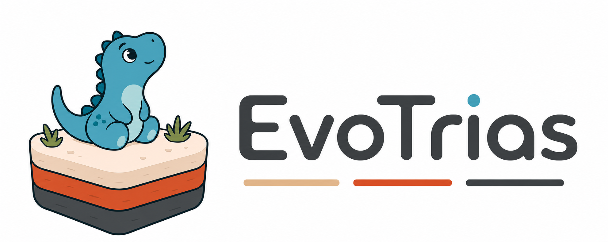

<div align="center">



[English](../README.md) | **中文**

</div>

EvoTrias 将编码智能体、基准评估器和持久化搜索状态组织在同一个进化循环中。
只需提供优化任务与验证器，它就能并行探索多种方向、评估候选方案、保留有效发现，
并基于当前最优结果持续搜索。

## 核心能力

- **并行探索**：从彼此不同的初始方向出发，以滚动任务队列持续生成候选方案。
- **验证器驱动**：候选方案的适应度由各基准自带的评估器决定，任务评分逻辑与控制器解耦。
- **持久化搜索经验**：记录成功候选、谱系、尝试历史和本轮 Notes，供后续任务复用。
- **策略自适应**：检测搜索停滞，并可生成有使用上限的元指导，以改进或替换当前策略。
- **实时可观测**：只读仪表盘集中展示适应度、谱系、活跃任务、近期活动、Notes 和元指导。
- **可扩展基准**：内置数学、系统和算法类基准技能，同时由每个基准独立维护评估契约。

## 工作原理

```text
宿主编码智能体
  └─ 初始化运行、调度任务，并仅按 ID 委派元指导请求
       ↓
Evolution Controller MCP
  ├─ 管理选择、谱系、Notes、收敛状态和元指导状态
  └─ 向无状态的 meta-guidance-generator 智能体提供 pending request
       ↓
任务执行智能体
  └─ 生成候选方案并调用基准验证器
       ↓
基准评估器
  └─ 向控制器返回归一化适应度与产物
```

控制器将详细状态持久化到磁盘，只向智能体传递紧凑的任务上下文。这样，长时间运行的
搜索可以复用既有发现，而不会不断占用宿主智能体的上下文窗口。

## 快速开始

### 环境要求

- Python 3.10–3.13
- [uv](https://docs.astral.sh/uv/)
- 使用内置插件工作流时需要
  [Claude Code](https://docs.anthropic.com/en/docs/claude-code)

### 安装

在仓库根目录运行：

```powershell
python -m pip install -r requirements.txt
uv sync --extra adrs --extra math --extra dev
uv run python benchmarks/install.py --all
```

基准安装脚本会将内置基准技能及其评估命令注册到
`.claude/settings.local.json`。

### 运行基准

加载 EvoTrias 工作流与基准插件并启动 Claude Code：

```powershell
claude --plugin-dir agent_evolve_plugin --plugin-dir benchmarks
```

然后提交进化任务：

```text
/agent_evolve_plugin:evolve run the circle_packing benchmark end to end.
```

EvoTrias 会在 `runs/` 下创建具名运行，启动仪表盘，探索多个初始方向，并持续调度
候选方案，直至达到配置的任务预算或时间预算。

## 仓库结构

```text
agent_evolve_mcp/       进化控制器与持久化层
agent_evolve_plugin/    工作流技能与任务执行智能体
benchmarks/             基准技能、评估器与参考资料
docs/                   集成指南
tests/                  控制器与基准回归测试
```

运行产物保存在 Git 忽略的 `runs/` 和 `.agent_evolve/` 目录中。每次完成的运行都会
生成机器可读结果和简洁的 Markdown 总结。

## 默认设置与运行时开关

| 设置 | 默认值 | 作用 |
| --- | ---: | --- |
| 初始探索方向 | 4 | 根探索分支数量 |
| 最大并发任务数 | 4 | 滚动调度队列上限 |
| 默认任务预算 | 50 | 请求未指定任务数时使用 |
| 停滞检测窗口 | 5 个成功候选 | 用于判断搜索是否停滞 |
| 停滞耐心值 | 4 | 连续达到停滞条件后触发策略调整 |
| 适应度提升阈值 | 0.0 | 最优适应度只要正向提升即视为进展 |
| 每次元指导数量 | 3 | 单次生成的不同元指导上限 |
| 每条元指导使用次数 | 2 | 每条指导最多分配给多少个任务 |
| 已尝试元指导保留数 | 10 | 后续生成指导时可参考的结果历史 |

运行初始化后配置即被锁定。下列环境变量需要在 MCP 进程启动前设置：

```powershell
# 关闭元指导，但保留停滞诊断和正常选择逻辑。
$env:AGENT_EVOLVE_META_EVOLVE_ENABLED = "0"

# 关闭本轮 Notes。
$env:AGENT_EVOLVE_NOTES_ENABLED = "0"

# 关闭仪表盘自动启动。
$env:AGENT_EVOLVE_UI_ENABLED = "0"

# 将低于 1% 的相对最优适应度提升视为停滞。
$env:AGENT_EVOLVE_PERF_IMPROVEMENT_THRESHOLD = "0.01"

# 将控制器状态保存到项目默认目录之外。
$env:AGENT_EVOLVE_CONTROLLER_DIR = "D:\evotrias-state"
```

无论是否检测到停滞，任务预算和时间预算始终有效。

## 运行产物

EvoTrias 将面向用户的运行输出与控制器内部状态分开保存：

```text
runs/<run_id>/
  completed_tasks.jsonl
  dashboard.json
  tasks/<task_id>/attempts/<attempt_id>/solution.py  # 或 solution.cpp
  tasks/<task_id>/attempts/<attempt_id>/eval_result.json
  run_summary.md
  run_summary.json
```

```text
.agent_evolve/controller/<run_id>/
  success_db.json
  attempts.jsonl
  task_contexts.json
  run_state.json
  notes.json
  meta_guidance/meta_guidance_state.json
  meta_guidance/meta_guidance_uses.jsonl
```

这两个位置都属于本地运行状态，并已被 Git 忽略。需要分享结果时，应使用最终总结或
经过整理的基准报告，而不是提交完整运行目录。

## 开发与测试

```powershell
.\.venv\Scripts\python.exe -m pytest -q
.\.venv\Scripts\python.exe -m compileall agent_evolve_mcp agent_evolve_plugin benchmarks
```

如需接入其他智能体宿主，请参考
[JiuwenClaw 集成指南](integration-jiuwenclaw.md)。
