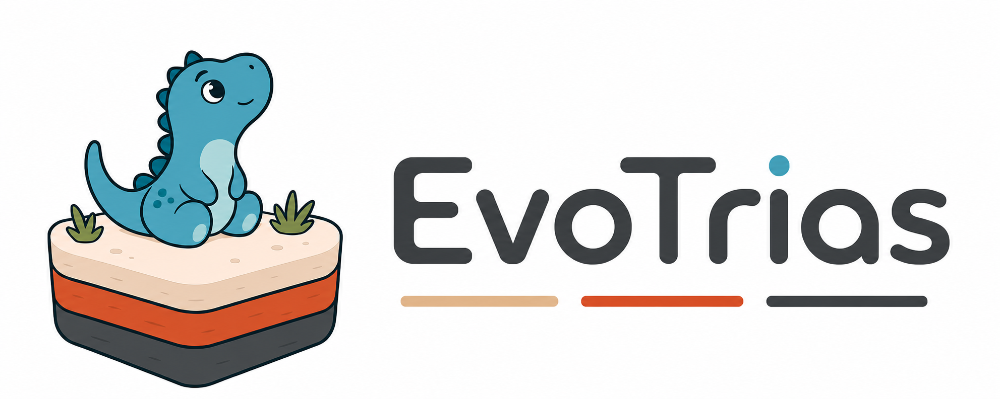

<div align="center">



**English** | [中文](docs/README_CN.md)

</div>

EvoTrias coordinates coding agents, task evaluators, and persistent search
state in one evolution loop. Give it an optimization task and a verifier; it
explores multiple directions, evaluates candidates, preserves useful discoveries,
and keeps searching from the strongest results.

## Highlights

- **Parallel exploration** — starts from distinct root directions and maintains a
  rolling queue of candidate-generation tasks.
- **Verifier-driven search** — task-owned evaluators decide candidate fitness,
  keeping task-specific scoring separate from the controller.
- **Persistent search intelligence** — records successful candidates, lineage,
  attempts, and run-local Notes for later tasks.
- **Strategy adaptation** — detects plateaus and can generate bounded meta-guidance
  to refine or replace the current search strategy.
- **Live observability** — includes a read-only dashboard for fitness, lineage,
  active tasks, recent activity, Notes, and meta-guidance.

## How It Works

```text
Host coding agent
  └─ initializes the run, schedules tasks, and delegates meta requests by ID
       ↓
Evolution Controller MCP
  ├─ manages selection, lineage, Notes, convergence, and meta-guidance state
  └─ exposes pending requests to a stateless evotrias-meta-guidance-generator agent
       ↓
evotrias-task-executor agents
  └─ generate candidates and invoke the task evaluator
       ↓
Task evaluators
  └─ return normalized fitness and artifacts to the controller
```

The controller keeps detailed state on disk and exchanges compact task contexts
with agents. This lets long-running searches reuse prior discoveries without
filling the host agent's context window.

## Quick Start

### Prerequisites

- Python 3.11+
- [Claude Code](https://docs.anthropic.com/en/docs/claude-code) or
  [opencode](https://opencode.ai)

### Install

From the repository root:

```bash
pip install ./evo_trias
```

### Set Up a Workspace

```bash
mkdir my-workspace
cd my-workspace
evotrias setup
```

Pick a harness and setup installs the EvoTrias agents, skills, and harness
configuration into the workspace. Run `evotrias setup` again to add the other
harness to the same workspace.

### Add the Task to Evolve

Write the task as a skill: its `SKILL.md` describes the task, how a candidate
solution is produced, and how a candidate is evaluated. Copy the skill directory
into the workspace's skills directory (setup shows where).

### Run

```bash
evotrias
```

This starts the harness set up last. Then submit an evolution task that names
the task skill:

```text
/evolve evolve <task skill name>
```

EvoTrias creates a named run under `runs/`, launches the dashboard, explores
several initial directions, and continues scheduling candidates until the
configured task or time budget is exhausted.

## Repository Layout

```text
evotrias/               Core package: db (state), evolve_ctrl (evolution control), scheduler, permissions, mcp (server entry), hooks, dashboard, setup, cli
evotrias/templates/     Agents, skills, and harness configuration installed by "evotrias setup"
docs/                   MCP interface reference
```

The controller MCP tool contract is documented in [docs/mcp_interface.md](docs/mcp_interface.md).

Runtime artifacts are written to the gitignored `runs/` and `.evotrias/`
directories. Each completed run includes machine-readable results and a concise
Markdown summary.

## Defaults and Runtime Switches

| Setting | Default | Effect |
| --- | ---: | --- |
| `LINEAGE_ROOT_NUMBER` | 4 | Initial exploration directions, number of root exploration branches |
| `MAX_CONCURRENT_TASKS` | 4 | Rolling scheduler queue limit |
| `MAX_TOTAL_TASKS` | 50 | Hard task budget |
| Plateau window | 5 successes | Window used for plateau diagnostics |
| Plateau patience | 4 | Consecutive plateau count required before strategy adaptation |
| Fitness improvement threshold | 0.0 | A positive running-best improvement is progress |
| Meta-guidance items per request | 3 | Maximum distinct guidance items generated |
| Uses per guidance item | 2 | Maximum tasks assigned to each item |
| Retained tried guidance | 10 | Outcome history available to later guidance requests |

The three scheduling values above can be stated in the evolve request (for
example "6 initial directions, 8 in parallel, 200 tasks"); they will be confirmed before 
creating the run and locked when a run is initialized.

Set these environment variables before starting the MCP process; they are
resolved once by `configure_run` and frozen into the run's `config.json`:

```powershell
# Disable meta-guidance while retaining plateau diagnostics and normal selection.
$env:EVOTRIAS_META_EVOLVE_ENABLED = "0"

# Disable run-local Notes.
$env:EVOTRIAS_NOTES_ENABLED = "0"

# Disable automatic dashboard startup.
$env:EVOTRIAS_UI_ENABLED = "0"

# Treat relative best-fitness improvement below 1% as plateau.
$env:EVOTRIAS_PERF_IMPROVEMENT_THRESHOLD = "0.01"
```

Hard task and time budgets remain active independently of plateau detection.

For remote access, set these before starting EvoTrias:

```bash
export EVOTRIAS_UI_HOST=0.0.0.0
export EVOTRIAS_UI_PUBLIC_HOST="<HOST_OR_IP>"
```

Use the URL printed by EvoTrias. Leave these variables unset for local-only access.

## Run Artifacts

EvoTrias separates the agent workspace from controller-owned state. Both are
relative to the working directory:

```text
runs/<run_id>/                                        agent workspace
  tasks/<task_id>/direction.txt                       written by evotrias-init-explorer
  tasks/<task_id>/attempts/<attempt_id>/solution.py   written by evotrias-task-executor (or solution.cpp)
  tasks/<task_id>/attempts/<attempt_id>/eval_result.json
  run_summary.md                                      written by finalize_run
  run_summary.json
```

```text
.evotrias/
  db/runs/<run_id>/   controller state (config, run state, attempts, notes, meta-guidance, task pool)
  hooks/              hook-private state
  locks/              cross-process locks
  logs/               MCP process logs
```

The per-run state files are listed in [docs/mcp_interface.md](docs/mcp_interface.md)
(section 3). Both locations are local runtime state and are ignored by Git. Share
the final summaries or a curated report instead of committing complete
run directories.
