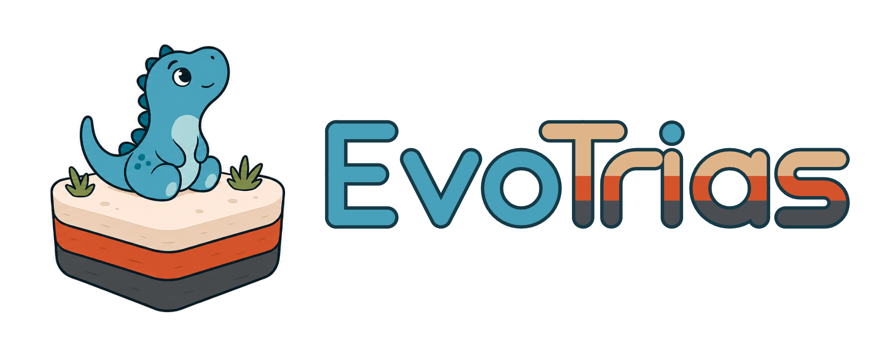

<div align="center">



**为编码智能体赋予程序进化能力**

[](pyproject.toml)
[](../LICENSE)
[](https://gitcode.com/openJiuwen/FAST-Evolve/releases)
[](https://evotrias.github.io/)

[English](README.md) | **中文** | [官网](https://evotrias.github.io/)

</div>

## 项目定位

**EvoTrias** 是一个面向编码智能体的程序进化插件。只需提供优化任务与评估器，即可驱动现有编码智能体持续生成、评测和筛选候选程序，并在当前最优解的基础上迭代优化。

## 核心特性

- ⚖️ **三权分治架构**：将程序进化中的治理（govern）、提案（propose）、裁决（judge）三类决策分别交由 Structured Governance、Open Proposal、Protected Judgment 三个平面独立负责。平面之间仅通过类型化契约交互，运行时 hooks 确保权责互不越界。
- 🔌 **插件化接入**：以 skill、MCP 服务和 hooks 的形式部署到工作区，无需改造编码智能体本身，即可为其赋予多方向、跨轮次的进化能力，同时完整保留其在大型代码仓中的自主开发能力。
- 🧭 **证据驱动的策略搜索**：控制器将评测结果提炼为多层级证据，据此自适应地选择父代与 inspiration，搜索随预算推进由广及深。检测到停滞时生成 Meta-guidance 以跳出平台期，有效的单次经验沉淀为 Notes 供后续任务复用。搜索状态由控制器持久化，不占用 agent 上下文。
- 🛡️ **评测隔离**：任务契约公开，评估器私有。权限 hooks 在工具调用层拦截对评估器源码及其他任务结果的访问，候选仅获得归一化的有效性、适应度与指标，确保分数如实反映解的质量。
- 📊 **实时可观测**：每次运行自动启动只读仪表盘，集中展示适应度变化、谱系、活跃任务、Notes 与 Meta-guidance；运行结束后生成结构化结果与 Markdown 总结。

### 支持的编码智能体

| 编码智能体 | 支持状态 | 说明 |
| --- | :---: | --- |
| [Claude Code](https://docs.anthropic.com/en/docs/claude-code) | ✅ 完整支持 | 调度与权限 hooks 完整生效，适用于长时间无人值守运行 |
| [OpenCode](https://opencode.ai) | ✅ 已支持 | 进化主流程完整可用，权限 hooks 适配中 |
| [Codex](https://github.com/openai/codex) | 🗓️ 规划中 | — |
| [JiuwenSwarm](https://gitcode.com/openJiuwen/jiuwenswarm) | 🗓️ 规划中 | — |

## 相关文档

<!-- 待补充：指向仓内 docs、examples 与 Release 的链接 -->

## 环境要求

| 项目 | 要求 |
| --- | --- |
| 操作系统 | Linux、macOS 或 Windows |
| Python | ≥ 3.11 |
| 编码智能体 | 支持范围见[支持的编码智能体](#支持的编码智能体) |

## 安装指南

```bash
git clone https://gitcode.com/openJiuwen/FAST-Evolve.git
pip install ./FAST-Evolve/evo_trias
```

执行以下命令检查安装结果，正常情况下将输出 evotrias 版本：

```bash
evotrias --version
```

## Quick Start

本节以 Claude Code 为例，使用仓库内置的 Circle Packing 基准演示完整的进化流程。该任务要求在单位正方形内放置 26 个互不重叠的圆，使其半径之和最大。

**1. 安装任务依赖**

```bash
pip install -r FAST-Evolve/benchmarks/requirements/math.txt
```

**2. 初始化工作区**

```bash
mkdir my-workspace && cd my-workspace
evotrias setup claude
```

该命令将 subagent、skill、MCP 配置与 hooks 安装至当前目录。使用其他编码智能体时，将 `claude` 替换为对应名称；省略名称则进入交互式选择界面。

**3. 导入待进化任务**

```bash
cp -r ../FAST-Evolve/benchmarks/skills/circle-packing .claude/skills/
```

任务以 skill 形式提供，需放入工作区的 skill 目录。不同编码智能体的 skill 目录不同，例如 OpenCode 为 `.opencode/skills/`。

**4. 启动进化**

```bash
evotrias
```

在启动的会话中，通过 `evolve` skill 提交进化请求：

```text
/evolve evolve circle-packing, 2 initial directions, 2 in parallel, 10 tasks
```

确认运行参数后，EvoTrias 在 `runs/` 下创建运行目录并输出仪表盘地址，随后从多个初始方向并行探索，再围绕当前最优解持续进化，直至任务预算耗尽。运行总结位于 `runs/<run_id>/run_summary.md`。

> [!TIP]
> 如需优化自定义问题，可将其编写为 skill：在 `SKILL.md` 中说明优化目标、候选程序的产出路径及评估器的调用方式，并放入工作区 skill 目录。[`benchmarks/skills/`](../benchmarks/skills/) 下的各基准任务可作为编写参考。

## License

本项目基于 [Apache License 2.0](../LICENSE) 开源。

本产品仅作为流程编排工具，不包含 AI 模型能力；用户在连接 AI 模型用于特定业务场景时，需自行承担欧盟 AI 法案等相关合规义务。
